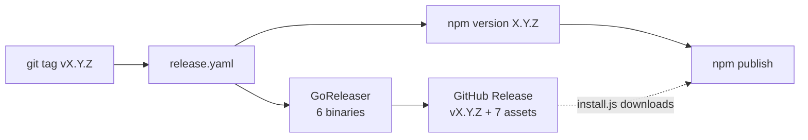

# Publishing to npm

How `piper` reaches npm, what broke on the way, and the conditions that must
hold before a release can be published.

The Go CLI is built and released by GoReleaser. A thin Node package in `npm/`
wraps it, because npm cannot publish a native executable: it ships a JS shim
that spawns a binary downloaded from the matching GitHub release.

> **No secrets live in this document.** Only secret *names* and where to create
> them. Never paste a token into a file, a commit, an issue, or a chat.

---

## 1. How the pieces fit



The order matters. `install.js` resolves the binary URL from the package
version, so the GitHub release for that exact tag must exist when someone runs
`npm install`. The workflow runs GoReleaser first for this reason.

| Path | Role |
| --- | --- |
| `.goreleaser.yaml` | Cross-compiles linux/windows/darwin × amd64/arm64, archives them |
| `.github/workflows/release.yaml` | Release + npm publish, triggered by any tag |
| `npm/package.json` | Package metadata, `bin` entry, `files` allowlist |
| `npm/install.js` | `postinstall`: downloads and unpacks the binary into `vendor/` |
| `npm/bin/piper.js` | The actual `piper` command; spawns the binary |
| `npm/lib/platform.js` | Maps Node `platform`/`arch` to GoReleaser asset names |

---

## 2. Conditions to publish

All of these must be true. Skipping any one produces a specific error, listed in
section 5.

### Required account and repo state

- [ ] **The npm scope belongs to you.** The package is `@deuce/piper`, and the
      npm account that owns the scope is `deuce`. A scope is the part after `@`;
      publishing to a scope you don't own fails with `E404`.
- [ ] **You are the maintainer** of the package on npm (`npm owner ls @deuce/piper`).
- [ ] **The GitHub repo has an `NPM_TOKEN` secret** (Settings → Secrets and
      variables → Actions). Must be a token that can bypass 2FA, otherwise CI
      fails with `EOTP` — see section 3.
- [ ] **`PUBLISHER_TOKEN` secret exists** and can write releases (already used
      by GoReleaser).

### Required version state

- [ ] **The version has never been published.** npm permanently rejects a
      re-publish of an existing version. Always bump the tag.
- [ ] **`package.json` version matches the tag.** You do not edit this by hand;
      the workflow stamps it from `${GITHUB_REF_NAME#v}`, so tag `v0.2.0` becomes
      npm `0.2.0` and downloads `releases/download/v0.2.0/...`.
- [ ] **The Go module builds without cgo** for every target in `.goreleaser.yaml`.
      See section 4 — this is what silently broke the first attempts.

### Required workflow configuration

- [ ] `permissions: id-token: write` is present. `npm publish --provenance`
      signs an attestation through GitHub's OIDC provider and fails without it.
- [ ] `permissions: contents: write` is present for GoReleaser to create the
      release.

---

## 3. The two tokens

### `NPM_TOKEN` (repository secret)

Create at <https://www.npmjs.com/settings/deuce/tokens> → **Granular Access
Token**:

| Field | Value |
| --- | --- |
| Packages and scopes | `@deuce/piper` |
| Permissions | **Read and write** |
| Bypass two-factor authentication | **enabled** |

The 2FA bypass is not optional. Without it, CI aborts with `EOTP: This operation
requires a one-time password`, because CI cannot answer a 2FA prompt.

An **Automation** classic token also works (it is always 2FA-exempt) but grants
publish rights on all your packages, so a granular token is the narrower choice.

Then add it as `NPM_TOKEN` under the repo's Actions secrets. Read it only
through `${{ secrets.NPM_TOKEN }}` in the workflow — never echo it, never write
it to a log, never `cat` the token file.

### `PUBLISHER_TOKEN` (repository secret)

A GitHub token with `contents: write` on this repo, used for creating the
release. Already configured.

### Keeping them safe

- Tokens are **write access to your packages**. Treat them like passwords.
- Never commit a token, and never paste one into a chat, issue, or PR.
- Use expiry dates and rotate before they lapse; an expired `NPM_TOKEN` makes
  every future release fail at the publish step with `ENEEDAUTH`.
- If a token is ever exposed, revoke it on npmjs.com immediately and add a new
  secret. Revoking invalidates it everywhere at once.

---

## 4. Audio and cgo (the trap that cost two red builds)

`oto` is the audio backend. Its **Linux** driver changed shape:

| `oto` version | Linux build requirement |
| --- | --- |
| ≤ v3.3.2 | cgo **+ ALSA dev headers** (`alsa/asoundlib.h`) |
| ≥ v3.5.0 | none — pure-Go PulseAudio, ALSA `dlopen`ed at runtime |

The project was on `v3.3.2`, so `CGO_ENABLED=0` left `oto`'s Linux driver with
no implementation at all: `undefined: newContext`. Switching on cgo then failed
in CI with `fatal error: 'alsa/asoundlib.h' file not found`, because the header
install and the actual compiler were not looking in the same place.

The fix was to **upgrade instead of fight it**:

```sh
go get github.com/ebitengine/oto/v3@latest
go mod tidy
```

At `v3.5.1` all six targets build statically, and `.goreleaser.yaml` is back to
one simple build matrix with `CGO_ENABLED=0`. **Do not reintroduce cgo for
Linux** — if a future dependency wants it, check whether an update removes the
need first.

Runtime note: on Linux the user needs `libasound.so.2` present (present on
virtually all desktops) if the PulseAudio path is unavailable.

---

## 5. Error → cause → fix

| Error | Cause | Fix |
| --- | --- | --- |
| `404 Not Found - PUT .../@scope%2fname` | Publishing to a scope you don't own, or wrong account | Rescope the package, or log in as the scope owner |
| `ENEEDAUTH` / `need auth` | `NPM_TOKEN` missing, empty, or expired | Create/refresh the secret |
| `EOTP` / requires one-time password | Token cannot bypass 2FA | Recreate as granular **with** 2FA bypass |
| `EUSAGE: Provenance generation ... requires "write" access to the "id-token" permission` | Missing permission | Add `id-token: write` to the workflow `permissions` |
| `EPUBLISHCONFLICT` / `403 ... cannot publish over the previously published versions` | Version already exists | Bump the tag; never reuse a version |
| `undefined: newContext` | `CGO_ENABLED=0` with an old `oto` | Upgrade `oto` (see section 4) |
| `fatal error: 'alsa/asoundlib.h' file not found` | cgo enabled without ALSA headers on the build host | Same — upgrade `oto` |
| Install fails to download, `HTTP 404` on the release URL | No GitHub release for the package version | Run GoReleaser for that tag first |
| Install prints `skipping binary download` | `PIPER_SKIP_DOWNLOAD=1` set | Unset it |
| `npm warn install-scripts ... not yet covered by allowScripts` | npm 11.4+ does not run dependency install scripts by default | Not fatal — see below |

### npm's install-script gate

npm 11.4+ refuses to run a dependency's install scripts unless they are
allowlisted. Users therefore see:

```
npm warn install-scripts   @deuce/piper@0.1.1 (postinstall: node install.js)
```

Two escape hatches are documented in the READMEs:
`--allow-scripts=@deuce/piper` for one install, or
`npm config set allow-scripts=@deuce/piper --location=user` for all installs.

**The package must not depend on the postinstall running.** `install.js` treats
every failure as a warning, and `bin/piper.js` re-attempts the download on first
run, so a blocked script is a slower first run rather than a broken install.
Keep that property: if the shim ever requires `vendor/` to exist, every npm
11.4+ user gets a broken CLI.

---

## 6. Release checklist

```sh
# 1. Be on main, tests green
go test ./...

# 2. Confirm the version is unused — MUST be empty
npm view @deuce/piper versions --json

# 3. Tag and push (this is what starts everything)
git tag -a vX.Y.Z -m "vX.Y.Z"
git push origin vX.Y.Z
```

Then verify:

```sh
# release assets exist
gh release view vX.Y.Z

# the package resolves and is tagged latest
npm view @deuce/piper version dist-tags

# it actually installs and runs, in a throwaway directory
npm install @deuce/piper
npx piper version
```

### Undoing a bad release

- **You cannot unpublish a version** after the npm restriction window, and even
  inside it, unpublishing breaks anyone who already installed.
- The supported move is to **publish a new patch** (`v0.1.2`) with the fix.
- You can move the `latest` dist-tag to a different version if a bad release is
  currently the default: `npm dist-tag add @deuce/piper@0.1.2 latest`.
- Deleting the GitHub release/tag does **not** remove the npm version. Only
  re-tagging a version that is still unpublished gives a clean rerun.

---

## 7. Local publishing (fallback)

CI is the normal path. To publish from a laptop:

```sh
cd npm
npm login                     # answer the 2FA/browser prompt yourself
npm version X.Y.Z --no-git-tag-version
npm publish --access public
```

Notes:

- This needs the GitHub release to exist already, or installs will 404.
- `--provenance` will not produce an attestation outside GitHub Actions; that is
  expected and harmless.
- Never run `npm publish` with a token exported in your shell history. Prefer
  `npm login`, which stores credentials in the npm config, not in a command.

---

## 8. Things worth keeping tidy

- `.goreleaser.yaml` uses `project_name: piper` (lowercase). Asset names are
  `piper_<Os>_<Arch>.tar.gz`, and `piper_Windows_<Arch>.zip`. Changing this
  casing silently breaks `npm/lib/platform.js`.
- Only `x64` and `arm64` are shipped. `npm/package.json` declares the same via
  `os`/`cpu`, so other architectures get a clear install error instead of a
  broken binary.
- `npm/files` is an allowlist: only `bin/`, `lib/`, and `install.js` ship. Keep
  it that way so Go sources and `vendor/` never enter the tarball.
- Build output is already ignored by `.gitignore` (`/piper`, `/piper.exe`), which
  also covers `Piper` and `Piper.exe` on Windows' case-insensitive filesystem.
  Confirm with `git ls-files | Select-String -Pattern "^(Piper|piper)"` if in doubt.
